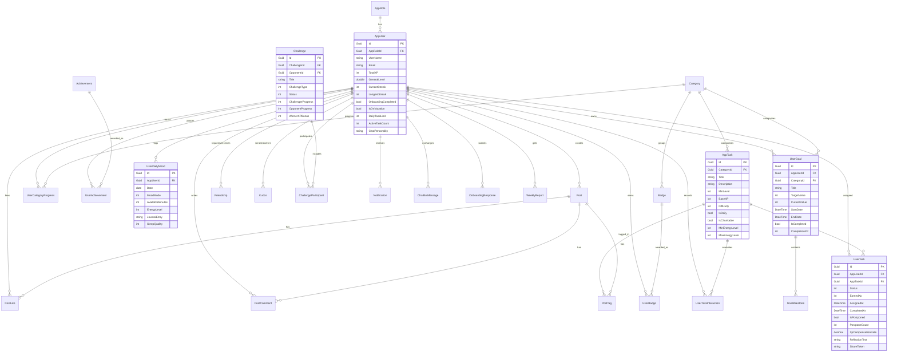

# 🌟 LifeQuest — Akıllı Alışkanlık, Görev Yönetimi ve Oyunlaştırma Platformu

[](https://dotnet.microsoft.com/)
[](https://react.dev/)
[](https://fastapi.tiangolo.com/)
[](https://www.postgresql.org/)
[](https://www.docker.com/)
[](https://dotnet.microsoft.com/apps/aspnet/signalr)
[](LICENSE)

---

## 📖 Proje Hakkında (Tanıtım)

**LifeQuest**, günlük hayatı, alışkanlıkları ve uzun vadeli hedefleri **RPG (Rol Yapma Oyunu)** mekanikleriyle harmanlayarak bir serüvene dönüştüren modern bir kişisel gelişim ve üretkenlik ekosistemidir.

Kullanıcılar; günlük görevleri tamamlayarak deneyim puanı (**XP**) kazanır, seviye atlar, rozetler ve başarımlar elde eder, arkadaşlarıyla rekabetçi mücadelelere (**Challenges**) katılır ve ruh hali/enerji takibi yaparak kişiselleştirilmiş içgörülere ulaşır. Platformun kalbinde yer alan **Yapay Zeka Destekli Akıllı Asistan**, kullanıcının duygu durumunu ve enerji düzeyini analiz ederek en uygun görevleri önerir ve motivasyon sağlar.

### ✨ Öne Çıkan Yetenekler
- 🎮 **Kapsamlı Oyunlaştırma:** Dinamik seviye/XP sistemi, başarımlar, gizli rozetler, liderlik tablosu ve streak takibi.
- 🤖 **Yapay Zeka & NLP Motoru:** Niyet sınıflandırma (*Intent Classification*), duygu analizi (*Sentiment Analysis*), aciliyet tespiti ve kişiselleştirilmiş yapay zeka sohbet botu.
- 🎯 **Akıllı Hedef ve Görev Yönetimi:** Alt kilometre taşları (*Milestones*), esnek kategoriler, zorluk seviyeleri, erteleme toleransı ve Pomodoro zamanlayıcı.
- 🤝 **Sosyal Ağ & Topluluk:** Arkadaşlık ilişkileri, tebrik/övgü (*Kudos*) gönderme, görsel içerikli durum paylaşımları, etiketleme ve arkadaş mücadeleleri (*Challenges*).
- 📊 **Duygu & Enerji Günlüğü:** Günlük ruh hali kaydı, uyku ve enerji takibi, yapay zeka destekli haftalık performans raporları.
- ⚡ **Gerçek Zamanlı İletişim:** SignalR tabanlı anlık bildirimler, canlı meydan okuma güncellemeleri ve sohbet entegrasyonu.
- 🛡️ **Kurumsal Mimari Güvencesi:** Clean Architecture, CQRS, MediatR, FluentValidation, Background Hosted Workers ve Docker konteynerizasyonu.

---

## 🏗️ Sistem Mimarisi ve Temel Bileşenler

LifeQuest, ölçeklenebilir, test edilebilir ve gevşek bağlı (**loosely coupled**) bir yapı sağlamak amacıyla **Clean Architecture** ve **Mikroservis Hibrit** prensiplerine uygun olarak inşa edilmiştir.

```
                    ┌────────────────────────────────────────────────────────┐
                    │               İstemci Katmanı (Client)                │
                    │               React + Vite SPA (Port 5173)             │
                    └───────────────────────────┬────────────────────────────┘
                                                │
                      HTTPS / JSON / Cookie Auth │ WebSocket (SignalR)
                                                ▼
┌─────────────────────────────────────────────────────────────────────────────────────────┐
│                     LifeQuest API (.NET 8 - ASP.NET Core Web API)                       │
├─────────────────────────────────────────────────────────────────────────────────────────┤
│  Presentation Katmanı:                                                                  │
│  - Controllers (Auth, Tasks, Goals, Social, Mood, Chat, Reports, Admin, Badges vb.)     │
│  - SignalR Hubs (/hubs/notification)                                                    │
│  - Middlewares: GlobalExceptionMiddleware, Serilog, Cookie/JWT Auth                      │
│  - Background Services: DailyQuestWorker, WeeklyReportWorker, NudgeWorker,              │
│    GoalRevisionWorker, GoalReminderWorker, ChallengeExpiryWorker                        │
├─────────────────────────────────────────────────────────────────────────────────────────┤
│  Core Katmanı:                                                                          │
│  - Application: CQRS Handlers (MediatR), Pipeline Behaviors (FluentValidation, Logging) │
│  - Domain: Entities (AppUser, AppTask, UserGoal, Badge vb.), Enums, Specifications      │
├─────────────────────────────────────────────────────────────────────────────────────────┤
│  Infrastructure Katmanı:                                                                │
│  - Persistence: EF Core, PostgreSQL DbContext, Repository Pattern, Seed Data            │
│  - Services: JwtTokenService (Refresh Token), SmtpEmailService (MailKit/MailHog)        │
└──────────────────────────┬────────────────────────────────────────────┬─────────────────┘
                           │                                            │
                           │ HTTP / JSON                                │ SQL / EF Core
                           ▼                                            ▼
┌──────────────────────────────────────────────────────┐  ┌───────────────────────────────┐
│        AI Mikro Servis (Python / FastAPI)            │  │          Veri Katmanı         │
├──────────────────────────────────────────────────────┤  ├───────────────────────────────┤
│  - IntentClassifier (scikit-learn)                   │  │  PostgreSQL 15 (Port 5432)    │
│  - SentimentAnalyzer (TF-IDF + ML Pipeline)          │  │  - İlişkisel Tablolar         │
│  - UrgencyDetector & ActionExtractor                 │  │  - JSONB Metadata Desteği     │
│  - PersonalityResponseGenerator                      │  │  - Connection Pooling         │
│  - CollaborativeFilter (Görev Öneri Algoritması)     │  │  pgAdmin 4 (Port 5050)        │
└──────────────────────────────────────────────────────┘  └───────────────────────────────┘
```

### 1. Presentation Katmanı (`LifeQuestAPI.API`)
- **ASP.NET Core 8 Web API:** Tüm HTTP uç noktalarını sunar, istekleri yönlendirir ve Swagger UI dokümantasyonunu sağlar.
- **SignalR (`NotificationHub`):** İstemciye anlık görev tamamlanma bildirimleri, seviye atlama duyuruları ve meydan okuma güncellemeleri fırlatır.
- **Background Hosted Services (Arka Plan İşçileri):**
  - `DailyQuestWorker`: Her gece yarısı kullanıcıların günlük görev havuzlarını yeniler, tamamlanmamış görevleri işler.
  - `WeeklyReportWorker`: Haftalık kullanıcı performans raporlarını hesaplar ve yapay zeka önerileriyle kaydeder.
  - `GoalRevisionWorker` & `GoalReminderWorker`: Pasif hedefleri tespit eder, revizyon modalı tetikler ve hatırlatmalar üretir.
  - `NudgeWorker`: Kullanıcıları tatil modu veya hareketsizlik durumlarında motive edici bildirimlerle uyarır.
  - `ChallengeExpiryWorker`: Süresi dolan düelloları/meydan okumaları otomatik olarak değerlendirir ve kazananlara XP dağıtır.

### 2. Core Katmanı (`LifeQuestAPI.Application` & `LifeQuestAPI.Domain`)
- **Domain Katmanı:** Harici kütüphanelerden bağımsız, saf iş kurallarını, enum'ları ve varlıkları (*BaseEntity*, *AppUser*, *AppTask*, *UserGoal*, *Challenge*, *Badge*, vb.) barındırır.
- **Application Katmanı:** 
  - **CQRS & MediatR:** İstekleri Komut (*Command*) ve Sorgu (*Query*) olarak ayrıştırır.
  - **Pipeline Behaviors:** İstek yaşam döngüsünde doğrulama (*FluentValidation*), loglama ve yetki kontrollerini otomatik yürütür.

### 3. Infrastructure Katmanı (`LifeQuestAPI.Infrastructure` & `LifeQuestAPI.Persistence`)
- **Persistence (Veri Kalıcılığı):** Entity Framework Core (PostgreSQL) üzerinden `LifeQuestDbContext`, Transaction yönetimi, Migration süreçleri ve otomatik `SeedData`.
- **Güvenlik & Servisler:**
  - `JwtTokenService`: 15 dakikalık Access Token ve 7 günlük Refresh Token mantığı (HTTP-Only Secure Cookie veya Bearer).
  - `SmtpEmailService`: Hesap aktivasyonu ve şifre sıfırlama işlemleri için asenkron HTML e-posta gönderimi (MailHog entegrasyonu).

### 4. AI Mikro Servisi (`ai_service`)
- **Python 3.10 & FastAPI:** Hızlı, asenkron ve hafif REST API servisi.
- **Makine Öğrenmesi & NLP Modelleri (scikit-learn):**
  - **Intent Classification:** Kullanıcı mesajının amacını tespit eder (*görev erteleme, moral arayışı, motivasyon, bilgi alma*).
  - **Sentiment Analysis:** Kullanıcı girdilerinin pozitif/negatif/nötr duygu skorunu çıkarır.
  - **Reflection Analyzer:** Görev tamamlama refleks metinlerini analiz ederek kullanıcıya ekstra bonus XP kazandırır.
  - **Contextual Recommendation:** Kullanıcının geçmiş tamamlamaları, kategori seviyeleri, o anki enerjisi ve saat dilimine göre en uygun görevleri puanlayarak önerir.

### 5. Frontend İstemcisi (`frontend`)
- **React 18 & Vite:** Yüksek performanslı tek sayfa uygulaması (SPA).
- **Tailwind CSS & Modern UI:** Glassmorphism detaylar, responsive mobil/masaüstü tasarımı, mikro etkileşimler ve erişilebilirlik.
- **SignalR Client Entegrasyonu:** Gerçek zamanlı bildirim zili ve canlı veri akışları.

---

## 🗄️ Varlık Bağıntı Modeli (Entity-Relationship Model)

Aşağıda LifeQuest veri tabanı mimarisinin görsel şeması ve tüm varlıkların birbirleriyle olan ilişkileri yer almaktadır:

### 📸 Veri Tabanı ER Şeması


---

### 🧩 İnteraktif Mermaid Varlık Bağıntı Diyagramı



### 📋 Temel Veri Modülü Özeti
| Modül | Temel Varlıklar | Açıklama |
|---|---|---|
| **Kimlik & Profil** | `AppUser`, `AppRole`, `OnboardingResponse` | Rol bazlı yetkilendirme, kullanıcı profili, seviye/streak takibi ve onboarding tercihleri. |
| **Görev Yönetimi** | `AppTask`, `UserTask`, `UserTaskInteraction` | Görev şablonları, kullanıcıya atanan anlık görevler, erteleme toleransları ve tamamlama refleksleri. |
| **Hedefler & İlerleme** | `UserGoal`, `GoalMilestone`, `Category`, `UserCategoryProgress` | Uzun vadeli hedefler, alt adımlar, kategori bazlı seviye ilerlemeleri ve istatistikler. |
| **Oyunlaştırma (Gamification)** | `Badge`, `UserBadge`, `Achievement`, `UserAchievement` | Kriter bazlı ve gizli rozetler, global başarımlar ve XP ödüllendirmeleri. |
| **Sosyal & Düello** | `Challenge`, `ChallengeParticipant`, `Friendship`, `Kudos` | 1v1 veya grup arkadaş mücadeleleri, arkadaşlık ağı ve motivasyonel tebrik mesajları. |
| **Topluluk Akışı** | `Post`, `PostComment`, `PostLike`, `PostTag` | Tamamlanan görevleri paylaşıp fotoğraf ve konum etiketleri ekleyebilme. |
| **Ruh Hali & Analiz** | `UserDailyMood`, `WeeklyReport` | Günlük ruh hali/enerji/uyku günlüğü ve yapay zeka destekli haftalık karne. |
| **Yapay Zeka & Bildirim** | `ChatBotMessage`, `Notification` | Sohbet geçmişi, duygu/niyet etiketleri ve SignalR anlık bildirim kuyruğu. |

---

## 🚀 Projeyi Başlatma ve Çalıştırma Rehberi

LifeQuest, tam teşekküllü **Docker Compose** altyapısına sahiptir. Projeyi ayağa kaldırmak için gereken tüm servisler (Veritabanı, pgAdmin, MailHog, AI Servisi, .NET API ve React Frontend) tek bir komutla veya sağlanan Windows scriptleri ile çalıştırılabilir.

### 📋 Ön Gereksinimler
- [Docker Desktop](https://www.docker.com/products/docker-desktop/) (Windows/macOS/Linux) ve **Docker Compose**
- *Opsiyonel (Konteyner dışı lokal geliştirme için):* .NET 8.0 SDK, Node.js 18+, Python 3.10+

---

### 1️⃣ Çevre Değişkenleri (.env) Hazırlığı

Projeyi ilk kez çalıştırmadan önce, örnek yapılandırma dosyasını kopyalayarak `.env` dosyanızı oluşturun:

**Windows PowerShell:**
```powershell
Copy-Item .env.example .env
```

**Komut İstemi (CMD):**
```cmd
copy .env.example .env
```

**Bash / Linux:**
```bash
cp .env.example .env
```

> **Not:** `.env` dosyasındaki veritabanı şifresi, portlar ve JWT secret anahtarı varsayılan olarak geliştirme ortamına uygun ayarlanmıştır. İhtiyaç halinde değiştirebilirsiniz.

---

### 2️⃣ Windows Scriptleri ile Tek Tıkla Başlatma (BAT & PowerShell)

Proje kök dizininde hazır başlatma ve durdurma betikleri yer almaktadır:

#### 🟢 Başlatma: `air.bat` veya `air.ps1`
- **Ne Yapar?** `docker-compose up -d --build` komutunu çalıştırır, tüm imajları sıfırdan derler, veritabanı bağımlılıklarını sırayla ayağa kaldırır ve hazır servis linklerini konsola yazdırır.
- **Nasıl Çalıştırılır?**
  - Dosya gezgininde `air.bat` dosyasına **çift tıklayabilir** ya da terminalden çalıştırabilirsiniz:
  ```cmd
  air.bat
  ```
  - Veya PowerShell ile:
  ```powershell
  .\air.ps1
  ```

#### 🔴 Durdurma: `stop.bat` veya `stop.ps1`
- **Ne Yapar?** `docker-compose down` komutunu işleterek çalışan tüm LifeQuest konteynerlerini güvenli şekilde durdurur.
- **Nasıl Çalıştırılır?**
  ```cmd
  stop.bat
  ```
  - Veya PowerShell ile:
  ```powershell
  .\stop.ps1
  ```

---

### 3️⃣ Docker Compose ile Manuel Yönetim

Herhangi bir işletim sisteminde terminal üzerinden doğrudan çalıştırmak için:

```bash
# Tüm servisleri arka planda derleyip başlatın
docker-compose up -d --build

# Canlı konteyner loglarını izleyin
docker-compose logs -f

# Yalnızca belirli bir servisin loglarını izleyin (örn. API veya AI)
docker-compose logs -f api
docker-compose logs -f ai_service

# Tüm servisleri durdurup kaldırın
docker-compose down
```

---

### 🌐 Servis Bağlantı Noktaları ve Erişim Adresleri

Konteynerler ayağa kalktıktan sonra aşağıdaki adreslerden erişebilirsiniz:

| Servis Adı | Açıklama | Erişim URL | Giriş Bilgileri |
|---|---|---|---|
| 🖥️ **Frontend (Web)** | React + Vite Kullanıcı Arayüzü | [http://localhost:5173](http://localhost:5173) | Kayıt ol veya Seed kullanıcısı |
| 🔌 **Backend API** | ASP.NET Core Swagger Arayüzü | [http://localhost:5020/swagger](http://localhost:5020/swagger) | JWT Bearer / Cookie |
| 🧠 **AI Servisi** | Python FastAPI Health & Docs | [http://localhost:5001/health](http://localhost:5001/health) | API Key (opsiyonel) |
| 🗄️ **pgAdmin 4** | PostgreSQL Görsel Veritabanı Yönetimi | [http://localhost:5050](http://localhost:5050) | **E-posta:** `admin@lifequest.com`<br>**Şifre:** `Admin123` / `admin` |
| ✉️ **MailHog** | Sahte SMTP E-posta Test Kutusu | [http://localhost:8025](http://localhost:8025) | Şifresiz Web UI |
| 🐘 **PostgreSQL DB** | Doğrudan SQL Bağlantısı | `localhost:5432` | **DB:** `LifeQuestDB`<br>**Kullanıcı:** `postgres`<br>**Şifre:** `StrongPass123` |

---

### 🛠️ Geliştiriciler İçin: Servisleri Lokal Olarak Ayrı Ayrı Çalıştırma (Opsiyonel)

Eğer kod üzerinde anlık debugging yapmak ve konteyner dışında çalıştırmak isterseniz:

1. **Yalnızca Veritabanı ve Mail Servislerini Başlatın:**
   ```bash
   docker-compose up -d db mailhog
   ```
2. **Backend API (.NET 8):**
   ```bash
   cd LifeQuestAPI/Presentation/LifeQuestAPI.API
   dotnet run
   ```
3. **AI Mikro Servis (Python):**
   ```bash
   cd ai_service
   python -m venv venv
   # Windows: .\venv\Scripts\activate | Linux/macOS: source venv/bin/activate
   pip install -r requirements.txt
   uvicorn main:app --reload --port 5001
   ```
4. **Frontend (React / Vite):**
   ```bash
   cd frontend
   npm install
   npm run dev
   ```

---

## 🔒 Güvenlik ve Gizlilik Notları

- `.env` ve hassas yapılandırma dosyaları `.gitignore` ile korunmakta olup versiyon kontrolüne dahil edilmez.
- Canlı ortama çıkmadan önce `JWT_SECRET`, veritabanı parolaları ve e-posta sunucu kimlik bilgileri güçlü anahtarlarla güncellenmelidir.

---

## 📄 Lisans

Bu proje [MIT](LICENSE) lisansı altında geliştirilmiştir. Katkıda bulunmaktan veya geri bildirim paylaşmaktan çekinmeyin!