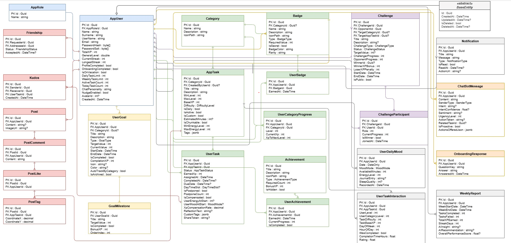

# LifeQuest

LifeQuest, günlük alışkanlıkları ve görev yönetimini RPG (rol yapma oyunu) dinamikleriyle birleştiren, yapay zeka destekli bir kişisel gelişim ve üretkenlik platformudur. Kullanıcılar görevleri tamamladıkça XP kazanır, seviye atlar, rozetler elde eder ve arkadaşlarıyla mücadelelere katılabilir.

---

## 🏛️ Mimari ve Temel Bileşenler

Proje loosely coupled (gevşek bağlı) ve modüler bir yapıda, katmanlı mimari ve mikroservis yaklaşımıyla geliştirilmiştir:

- **Backend (LifeQuestAPI):** .NET 8 (ASP.NET Core Web API) ile Clean Architecture prensiplerine uygun olarak inşa edilmiştir. CQRS (MediatR), FluentValidation, Entity Framework Core ve anlık bildirimler için SignalR kullanır. Arka planda görev yenileme, hedef hatırlatma ve raporlama işleri için Background Worker'lar (`DailyQuestWorker`, `WeeklyReportWorker` vb.) görev yapar.
- **Frontend:** React 18, Vite ve Tailwind CSS ile geliştirilmiş modern bir SPA (Single Page Application). Görev listesi, Pomodoro sayacı, sohbet botu ve sosyal akış sayfalarını barındırır.
- **AI Servisi (`ai_service`):** Python (FastAPI) tabanlı mikroservis. NLP ve scikit-learn modelleri kullanarak niyet sınıflandırma (intent), duygu analizi (sentiment), bağlamsal görev önerisi ve yansıma (reflection) analizlerini yürütür.
- **Veritabanı & Altyapı:** PostgreSQL ilişkisel veritabanı olarak kullanılır. Docker Compose tüm servisleri (.NET API, React Frontend, Python AI, PostgreSQL, pgAdmin ve MailHog) orkestre eder.

---

## 🗄️ Varlık Bağıntı Modeli (ERD)

Projenin veritabanı varlık bağıntı şeması:



---

## 🚀 Projeyi Başlatma

Projeyi Docker Compose veya kök dizindeki hazır betiklerle tek adımda çalıştırabilirsiniz.

### 1. Hazırlık
`.env.example` dosyasını kopyalayarak `.env` oluşturun:

```bash
# Windows (CMD)
copy .env.example .env

# Windows (PowerShell)
Copy-Item .env.example .env

# Linux / macOS
cp .env.example .env
```

### 2. Çalıştırma

#### Seçenek A: Batch Script ile (Windows)
Kök dizindeki `.bat` dosyaları Docker komutlarını otomatik yürütür:
- **Başlatmak için:** `air.bat` dosyasını çalıştırın *(arka planda `docker-compose up -d --build` komutunu çalıştırır)*.
- **Durdurmak için:** `stop.bat` dosyasını çalıştırın *(arka planda `docker-compose down` komutunu çalıştırır)*.

#### Seçenek B: Docker Compose ile (Manuel)
```bash
# Tüm servisleri derle ve arka planda başlat
docker-compose up -d --build

# Servisleri durdur
docker-compose down
```

---

## 🌐 Servis Portları ve Bağlantılar

Servisler ayağa kalktıktan sonra aşağıdaki bağlantılardan erişilebilir:

| Servis | Adres | Açıklama |
|---|---|---|
| **Frontend** | [http://localhost:5173](http://localhost:5173) | Web Uygulaması |
| **Backend API** | [http://localhost:5020/swagger](http://localhost:5020/swagger) | Swagger UI Dokümantasyonu |
| **AI Servisi** | [http://localhost:5001/health](http://localhost:5001/health) | Sağlık Kontrolü & API |
| **pgAdmin** | [http://localhost:5050](http://localhost:5050) | **Giriş:** `admin@lifequest.com` / `Admin123` |
| **MailHog** | [http://localhost:8025](http://localhost:8025) | E-posta Test Kutusu |